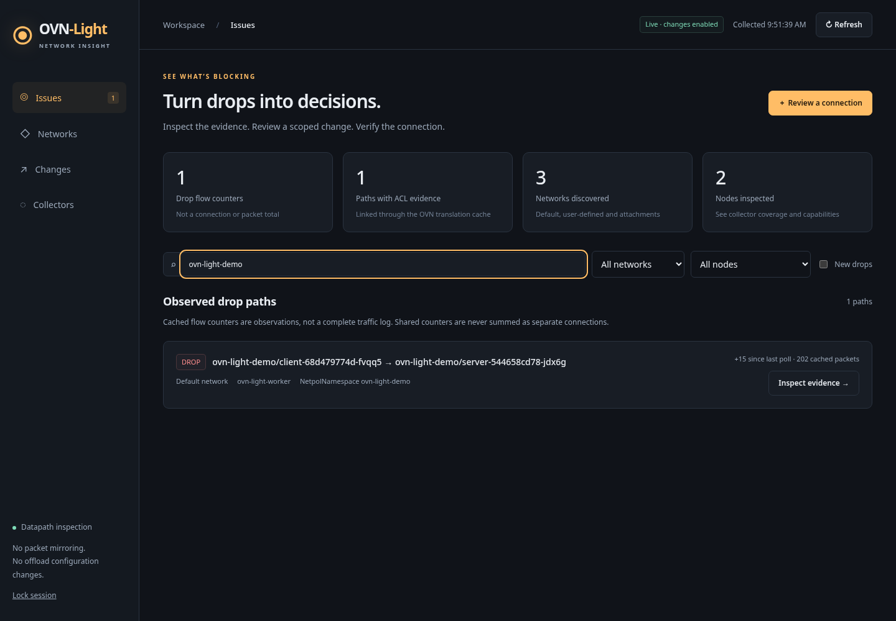

# OVN-Light

**See what’s blocking. Review a change. Verify the connection.**

OVN-Light is an experimental Go console for OVN-Kubernetes network troubleshooting. It inspects OVS datapath flow caches, follows compatible recirculations, maps pod attachments to networks, and links cached OpenFlow translations to OVN ACL ownership. It proposes additive NetworkPolicies, MultiNetworkPolicies and ClusterNetworkConnect resources for review in the browser.

The name is an oven light: a way to see what is happening inside OVN while it is running.



## Features

- Live collection from existing OVS/OVN containers without a packet sampler or changes to hardware offload configuration.
- Drop paths with UFIDs, masks, recirculations, counter deltas, shared-counter warnings and raw OpenFlow evidence.
- Pod and network identity, including primary UDNs and overlapping IP ranges. Filter by network, node, workload or policy.
- Namespace default-deny ACL attribution when the translation cache and OVN stage hints are available.
- NetworkPolicy or MultiNetworkPolicy proposals inferred from the observed attachment, with the affected network shown in review. Both ingress and egress are evaluated.
- Review affected pods and YAML, admission dry-run, apply, optional TCP verification, persistent change history and guarded rollback.
- Reviewed connections between two primary UDNs through ClusterNetworkConnect when its API is available.
- A self-contained web UI, offline snapshot replay and a clearly marked synthetic demo.

Flow caches are not packet histories. Missing or wildcarded fields remain unknown. A cached default-deny flow often does not identify a destination port; choose the intended connection in that case. Hardware offload visibility depends on the driver and device and is **not** validated by the KIND test. See [architecture and limitations](docs/architecture.md).

## Try the UI without a cluster

Requires Go 1.26 or newer.

```sh
go run ./cmd/ovn-light --demo
```

Open **http://127.0.0.1:8080**. Demo proposals can be reviewed and downloaded; they cannot be applied to a cluster.

## Deploy on an existing OVN-Kubernetes KIND cluster

Requires Go, Docker, KIND, kubectl, OpenSSL, and a working OVN-Kubernetes cluster. The manifests expect OVN in `ovn-kubernetes`, `ovs-daemons` and `ovnkube-controller` containers, local NB/SB database sockets, and a default storage class for the audit volume.

```sh
# Replace ovn with your KIND cluster name. The script preserves your current context.
./scripts/deploy-kind.sh ovn
kubectl --context kind-ovn -n ovn-light port-forward service/ovn-light 8080:8080
```

In another terminal, retrieve the token and paste it into the login screen:

```sh
kubectl --context kind-ovn -n ovn-light get secret ovn-light-auth \
  -o jsonpath='{.data.token}' | base64 -d
```

The deployment enables reviewed writes. To run read only, remove `--enable-writes` and the `create`/`delete` verbs for NetworkPolicy, MultiNetworkPolicy and ClusterNetworkConnect in `deploy/ovn-light.yaml`. Collection still requires `pods/exec` in the OVN namespace.

### Generate a denied connection

```sh
kubectl --context kind-ovn apply -f examples/denied-traffic.yaml
```

The example continuously attempts TCP/8080 from `client` to `server`, while `isolate-server` denies ingress. Both workloads run on the same node to make the first inspection straightforward.

1. Wait for the pods to be ready. Refresh the console and search for `ovn-light-demo`.
2. Inspect the drop path and ACL evidence.
3. Choose **Review a scoped allow rule**, or **Choose the intended connection** when the port is wildcarded. Select client → server, TCP/8080.
4. Review the YAML and matching pods, acknowledge the scope, and apply.
5. Use **Verify TCP connection**. The example grants probe permission only in its namespace.
6. Use **Roll back created resources** to remove the allowance. The original deny policy is preserved.

An API write is not a successful connectivity test. A disappearing cache entry is not considered success either.

### Run locally against a cluster

```sh
export OVN_LIGHT_TOKEN="$(openssl rand -hex 32)"
go run ./cmd/ovn-light --context kind-ovn --enable-writes --data-dir .data
```

Print `$OVN_LIGHT_TOKEN` in your own terminal to log in. Omit `--enable-writes` for read-only operation. Use `--kubeconfig /path/to/config` when needed.

### Capture and replay

```sh
go run ./cmd/ovn-light capture --context kind-ovn --output /tmp/ovn-light.json
go run ./cmd/ovn-light --snapshot /tmp/ovn-light.json
```

Snapshots contain workload metadata, policies and network topology. Treat them as cluster diagnostic data. Captures are written with mode `0600`.

## UDNs and network connections

Proposals opened from a drop keep its observed network fixed. The server infers the policy type from the actual pod attachment and records the scope in the proposal:

| Attachment | Proposed policy | Network scope |
| --- | --- | --- |
| CDN when primary | NetworkPolicy | Implicitly the namespace's primary network |
| Primary UDN or CUDN | NetworkPolicy | Implicitly the namespace's primary network |
| Secondary OVN network | MultiNetworkPolicy | Explicit `k8s.v1.cni.cncf.io/policy-for` NAD reference |

A regular NetworkPolicy has no network selector. Its `ovn-light.io/network` annotation is audit metadata, not an enforcement mechanism. MultiNetworkPolicy uses OVN's [policy-for targeting](https://ovn-kubernetes.io/1.4/features/multiple-networks/multi-network-policies/). Proposals evaluate only policies affecting the selected network; different NADs referring to the same OVN network are correlated. The CDN infrastructure attachment in a primary UDN namespace is not treated as a secondary network.

Secondary proposals require the MultiNetworkPolicy API, OVN-managed subnets and enabled OVN multi-network-policy enforcement. Existing applicable MultiNetworkPolicies must declare `policyTypes`; missing directions are not guessed. IPAM-less/DHCP selectors and automatic secondary-interface verification are not supported. A new connection review, or a drop with unresolved network identity, requires an explicit network choice.

`examples/secondary-network.yaml` provides two pods with separate CDN and secondary-network deny policies. This allows checking that a secondary allowance preserves primary-network isolation.

`examples/user-defined-networks.yaml` provides two disposable primary UDNs and workloads. See [validation and reproduction](docs/testing.md) for the tested workflow and cluster prerequisites.

**Networks → Connect networks** generates a ClusterNetworkConnect for two primary UDNs. Choose a connect subnet from your address plan. The planner rejects known overlap and requires selectors that match exactly the chosen networks in current inventory. ClusterUserDefinedNetworks need suitable existing labels. The UI never silently labels or rewrites a network. Cross-network NetworkPolicy proposals are not supported.

## Access and deployment model

This is an administrator tool. The token grants access to the server’s service account; it does **not** impersonate the browser user’s Kubernetes identity. Use ClusterIP plus `kubectl port-forward`. An internet-facing deployment needs a TLS/authentication proxy and an appropriate authorization design.

The collector executes fixed, read-only commands. Kubernetes `pods/exec` is nevertheless a powerful permission. The API accepts connection intents, not arbitrary commands or manifests. Applied objects must come from stored, unexpired proposals. Rollback checks the recorded UID, owner annotation, spec hash and resource version before deleting.

For OpenShift, set `--ovn-namespace=openshift-ovn-kubernetes`, change the collector Role/RoleBinding namespace, and adapt the security context to the namespace’s SCC-assigned UID/group range. Container names and DB addresses may differ. KIND is the initial deployment target; an OpenShift operator and console plugin are not included.

## Development

```sh
make test   # Go tests with the race detector
make check  # go vet and JavaScript syntax check
make build  # bin/ovn-light
make image  # static binary in a scratch image; override IMAGE=... as needed
```

Collection, reconstruction, policy planning and the backend are Go. The embedded UI uses HTML, CSS and plain JavaScript, with no frontend build step or CDN. Optional browser checks use Playwright: run the demo, then `node scripts/browser-smoke.cjs` with Playwright installed in your development environment.

GitHub Actions runs Go race/vet checks, browser tests, and three isolated KIND integration lanes: CDN, primary UDN plus ClusterNetworkConnect, and secondary MultiNetworkPolicy. Each deploys OVN-Kubernetes and OVN-Light, observes a real policy drop, exercises proposal/apply/rollback through the API, and verifies traffic before and after. See [CI and local reproduction](docs/testing.md#continuous-integration).

Licensed under Apache-2.0. See [LICENSE](LICENSE).
