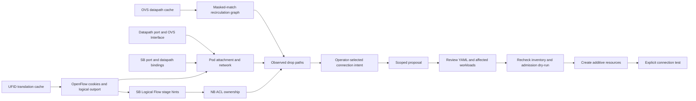

# Evidence, identity and remediation

OVN-Light uses existing node OVS/OVN containers as a version-matched command environment. A Go server executes fixed read commands through Kubernetes. This initial design suits KIND; a node-local collector protocol would reduce exec overhead and RBAC scope at scale.

## Collection

Each node supplies `ovs-appctl dpctl/dump-flows -m`, `dpctl/show`, OVS Interface rows, SB Port_Binding/Datapath_Binding/Logical_Flow rows, NB ACL rows, and `ofproto/detrace ufid:<id>` output for relevant flows. Commands have time and output limits. Node concurrency is three. Translation queries are bounded by `--max-detraces`; truncation and errors appear in Collectors.

Kubernetes inventory includes pods, namespaces, Services, NetworkPolicies, UDNs, NADs, CNCs, administrative policies and EgressFirewalls. An incomplete policy inventory prevents proposals. Missing optional CRDs are supported. Configure `--nb-db` and `--sb-db` for nonlocal database layouts. Pod discovery currently expects `ovs-daemons` or `ovs-vswitchd` and `ovnkube-controller` container names.

## Reconstruction and identity

A recirculation ID is a continuation context, not a connection ID. Compatible masks, ingress port and metadata constrain edges. IP, MAC and numeric masks are intersected. Wildcard ports stay unknown. Simple `set` actions update packet state; conntrack invalidates state constraints. NAT discards potentially translated tuple fields. Explicit matches after NAT, exact destination MACs, or logical outport evidence can restore destination identity.

Conditional actions, cloning and unmodeled rewrites retain warnings and prevent a precise recommendation. Ingress can expire before a downstream cached flow; these paths are partial. Depth, visit and path limits bound reconstruction and report incomplete evidence.

Counter deltas require the same node/UFID, unchanged actions and a nondecreasing counter. Resets produce no delta. Paths with a common terminal UFID share a counter: do not sum their counts. A cached flow can aggregate multiple tuples; an exact field does not turn a graph into a packet-by-packet trace.

Datapath port numbers differ from OpenFlow port numbers. Interface external IDs map the datapath port name to a logical port and pod UID. NAD configuration supplies OVN network names, while NAD ownership identifies UDNs/CUDNs. Tunnel ingress can use its logical datapath key and SB bindings. Exact logical outport/metadata matches in terminal OpenFlow evidence can recover a destination through SB Port_Binding even when its address is wildcarded. There is no global IP-to-pod fallback across UDNs. Cross-node paths are not stitched into one end-to-end graph in this release.

## Attribution

`ofproto/detrace` exposes cached translation rules for a live UFID when available. Logical-flow cookies correspond to the first 32 bits of SB Logical_Flow UUIDs. Stage hints link eligible logical flows to NB ACLs, whose external IDs identify their owner.

Attribution is best effort: cache eviction, absent hints, cookie collisions, shared logical flows and compiler details can prevent unique mapping. The UI displays candidate ACLs and raw evidence. `NetpolNamespace` often means shared namespace default deny, not one NetworkPolicy explicitly denying a tuple. The planner evaluates the additive union of policies.

## Proposals

Policy proposals require current labeled pods on the same network. The server derives NetworkPolicy for primary attachments and MultiNetworkPolicy for secondary attachments. Drop-based proposals retain the observed network; unresolved evidence and manually started reviews require an explicit selection. The review and audit record show the network, role, policy API and NADs.

Both directions are evaluated, including peer selectors (namespace AND pod), IPBlock exceptions, port ranges, protocols and named ports. Secondary evaluation includes only MultiNetworkPolicies whose `policy-for` NADs resolve to the selected OVN network. Each generated policy targets the appropriate attachment's NAD; primary NetworkPolicies do not receive a `policy-for` annotation. Multiple NADs may share one OVN network. Only isolated directions lacking an allowance receive a policy, and the affected-pod list includes only attachments on that network.

Secondary selector proposals require managed subnets and explicit `policyTypes` in existing applicable MultiNetworkPolicies. Ambiguous direction defaults, missing APIs/NADs and IPAM-less/DHCP networks are declined. The feature flag must be enabled in OVN: admission success alone does not establish enforcement. Full current pod labels favor narrow scope and can include rollout hashes; matching future pods also receive permission.

For primary networks, the planner conservatively declines when an AdminNetworkPolicy or BaselineAdminNetworkPolicy selects an endpoint, or an EgressFirewall controls the source. Their ordered semantics are not implemented here. Cross-network remediation is declined. No new allow is suggested when the selected network's policies already permit the connection.

Plans expire after ten minutes. Applying fetches inventory again, checks policy/network/identity inputs and repeats admission dry-run. Only generated objects are created. Multi-object creation is not transactional: partial failure is recorded, and positively recorded objects remain eligible for rollback. Policy changes can race the final inventory read; Kubernetes has no transaction spanning this check and all resource creates.

Audit records are atomically replaced JSON files in `--data-dir`. Use persistent storage and one replica. An interrupted mutation is marked on restart. A timed-out create may still have reached the API server: inspect all proposed object names before generating another plan. Rollback rejects changed UIDs, ownership, specs, MultiNetworkPolicy target annotations or resource versions. The audit is an administrative record, not a tamper-proof compliance log.

Primary-network verification runs an explicit TCP connection from the source container using an existing `python3`, `/agnhost` or `nc`. It installs nothing and does not substitute another pod identity. Success proves transport reachability, not application behavior. Secondary networks require a probe on the selected interface; the built-in probe is disabled for MultiNetworkPolicy proposals. UDP/SCTP and CNC verification also require application tests.

## Offload and coverage

Collection never installs flow rules, enables packet sampling, clears counters or changes offload. The running OVS instance supplies its datapath view, including offload metadata exposed by its provider. DPDK by itself is not classified as hardware offload.

This cannot guarantee visibility of every hardware drop. Device ACLs outside OVS, packets dropped before flow installation, driver aggregation, delayed counters and expired cache entries are outside coverage. Translation-cache availability and provider output vary. KIND validates only the software path; hardware fixtures and device validation remain separate work.

This release has no durable traffic time series, L7 parser, FQDN policy engine, automatic application dependency learning, multi-cluster relay, per-user Kubernetes impersonation or operator lifecycle management.
