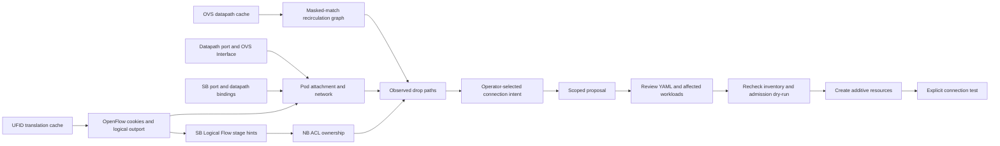

# Evidence, identity and remediation

OVN-Light uses existing node OVS/OVN containers as a version-matched command environment. A Go server executes fixed read commands through Kubernetes. This initial design suits KIND; a node-local collector protocol would reduce exec overhead and RBAC scope at scale.

## Collection

Each node supplies `ovs-appctl dpctl/dump-flows -m`, `dpctl/show`, OVS Interface rows, SB Port_Binding/Datapath_Binding/Logical_Flow rows, NB ACL rows, and `ofproto/detrace ufid:<id>` output for relevant flows. Commands have time and output limits. Node concurrency is three. Translation queries are bounded by `--max-detraces`; truncation and errors appear in Collectors.

Kubernetes inventory includes pods, namespaces, Services, NetworkPolicies, UDNs, NADs, CNCs, administrative policies and EgressFirewalls. An incomplete policy inventory prevents proposals. Missing optional CRDs are supported. Configure `--nb-db` and `--sb-db` for nonlocal database layouts. Pod discovery currently expects `ovs-daemons` or `ovs-vswitchd` and `ovnkube-controller` container names.

## Reconstruction and identity

A recirculation ID is a continuation context, not a connection ID. Compatible masks, ingress port and metadata constrain edges. IP, MAC and numeric masks are intersected. Wildcard ports stay unknown. Simple `set` actions update packet state; conntrack invalidates state constraints. NAT discards potentially translated tuple fields. Explicit matches after NAT, exact destination MACs, or logical outport evidence can restore destination identity.

Conditional actions, cloning and unmodeled rewrites retain warnings and prevent a precise recommendation. Ingress can expire before a downstream cached flow; these paths are partial. Depth, visit and path limits bound reconstruction and report incomplete evidence.

Counter deltas require the same node/UFID, unchanged actions and a nondecreasing counter. Resets produce no delta. Paths with a common terminal UFID share a counter: do not sum their counts. A cached flow can aggregate multiple tuples; an exact field does not turn a graph into a packet-by-packet trace.

Datapath port numbers differ from OpenFlow port numbers. Interface external IDs map the datapath port name to a logical port and pod UID. NAD configuration supplies OVN network names, while NAD ownership identifies UDNs/CUDNs. Tunnel ingress can use its logical datapath key and SB bindings. Exact logical outport/metadata matches in terminal OpenFlow evidence can recover a destination through SB Port_Binding even when its address is wildcarded. There is no global IP-to-pod fallback across UDNs. The topology correlates compatible observations across nodes while retaining each observation point and its counter provenance. It does not reconstruct an end-to-end packet trace.

## Attribution

`ofproto/detrace` exposes cached translation rules for a live UFID when available. Logical-flow cookies correspond to the first 32 bits of SB Logical_Flow UUIDs. Stage hints link eligible logical flows to NB ACLs, whose external IDs identify their owner.

Attribution is best effort: cache eviction, absent hints, cookie collisions, shared logical flows and compiler details can prevent unique mapping. The UI displays candidate ACLs and raw evidence. `NetpolNamespace` often means shared namespace default deny, not one NetworkPolicy explicitly denying a tuple. The planner evaluates the additive union of policies.

## Proposals

Policy proposals require current labeled pods on the same network. The server derives NetworkPolicy for primary attachments and MultiNetworkPolicy for secondary attachments. Drop-based proposals retain the observed network; unresolved evidence and manually started reviews require an explicit selection. The review and audit record show the network, role, policy API and NADs.

Both directions are evaluated, including peer selectors (namespace AND pod), IPBlock exceptions, port ranges, protocols and named ports. Secondary evaluation includes only MultiNetworkPolicies whose `policy-for` NADs resolve to the selected OVN network. Each generated policy targets the appropriate attachment's NAD; primary NetworkPolicies do not receive a `policy-for` annotation. Multiple NADs may share one OVN network. Only isolated directions lacking an allowance receive a policy, and the affected-pod list includes only attachments on that network.

Secondary selector proposals require managed subnets and explicit `policyTypes` in existing applicable MultiNetworkPolicies. Ambiguous direction defaults, missing APIs/NADs and IPAM-less/DHCP networks are declined. The feature flag must be enabled in OVN: admission success alone does not establish enforcement. Full current pod labels favor narrow scope and can include rollout hashes; matching future pods also receive permission.

For primary networks, the planner conservatively declines when an AdminNetworkPolicy or BaselineAdminNetworkPolicy selects an endpoint, or an EgressFirewall controls the source. Administrative policy remediation is not implemented here. EgressFirewall has a separate external-connection workflow. Cross-network remediation is declined. No new allow is suggested when the selected network's policies already permit the connection.

EgressFirewall ACL attribution reads `rule-index` (or legacy `rule-idx`) and associates the namespace with
its existing firewall. The separate planner accepts an exact external IP/port on
the primary CDN. It evaluates ordered CIDR rules and inserts a single host-prefix
allow immediately before the matching deny. Existing earlier allows suppress an
unnecessary proposal. Earlier DNS/node-selector rules with matching ports are
ambiguous and require manual review. Source NetworkPolicy egress must already
allow the connection; administrative policies remain a guard. The review lists
namespace-wide scope, original/proposed YAML and the insertion position.

The firewall patch atomically tests its UID and original spec before inserting.
Rollback checks the recorded post-apply spec hash and UID, then atomically tests
the current resource version and spec before removing just the inserted rule.
No ownership annotations are added to the user's firewall, and no EgressFirewall
is created or deleted. A later spec edit blocks rollback instead of overwriting it.

Plans expire after ten minutes. Applying fetches inventory again, checks policy/network/identity inputs and repeats admission dry-run. NetworkPolicy, MultiNetworkPolicy and CNC actions create generated objects. EgressFirewall actions patch the existing rule list. Multi-object creation is not transactional: partial failure is recorded, and positively recorded objects remain eligible for rollback. Policy changes can race the final inventory read; Kubernetes has no transaction spanning this check and all resource creates.

Audit records are atomically replaced JSON files in `--data-dir`. Use persistent storage and one replica. An interrupted mutation is marked on restart. A timed-out write may still have reached the API server: inspect all proposed object names before generating another plan. Rollback rejects changed UIDs, ownership, specs, MultiNetworkPolicy target annotations or resource versions. The audit is an administrative record, not a tamper-proof compliance log.

Primary-network and EgressFirewall verification run an explicit TCP connection from the source container using an existing `python3`, `/agnhost` or `nc`. It installs nothing and does not substitute another pod identity. Success proves transport reachability, not application behavior. Secondary networks require a probe on the selected interface; the built-in probe is disabled for MultiNetworkPolicy proposals. UDP/SCTP and CNC verification also require application tests.

## Offload and coverage

Collection never installs flow rules, enables packet sampling, clears counters or changes offload. The running OVS instance supplies its datapath view, including offload metadata exposed by its provider. DPDK by itself is not classified as hardware offload.

This cannot guarantee visibility of every hardware drop. Device ACLs outside OVS, packets dropped before flow installation, driver aggregation, delayed counters and expired cache entries are outside coverage. Translation-cache availability and provider output vary. KIND validates only the software path. Synthetic offload fixtures test interpretation; device validation remains separate work. See [hardware offload diagnostics](offload.md) for collection, correlation and alert semantics.

Traffic history is bounded and in memory. This release has no durable traffic time series, L7 parser, FQDN policy engine, automatic application dependency learning, multi-cluster relay, per-user Kubernetes impersonation or operator lifecycle management.

## Topology and scaling

The Go analyzer emits one observation per terminal node/UFID counter. Named OVS
output ports are resolved against `dpctl/show`. Known packet-length branches are
traversed separately; downstream counters remain independent of the branch's
input counter. A conditional output's parent counter is explicitly labeled
`branch-input`, and does not establish successful forwarding. Unknown actions,
shared paths, NAT and wildcard fields remain visible in the evidence.

Network identity and pod UID scope the conversation key. Ports may stay unknown;
we do not allocate a subnet-wide counter to one current pod. A sender may identify
only the destination node, while the receiver identifies the pod and port. The
node graph retains both observations; the pod graph keeps the unresolved endpoint
separate. Source, receiver, local and drop counters are never added into a single
end-to-end packet total. Deltas require a stable UFID, datapath, match, actions and
offload state, increasing counters and a positive capture interval.

The store retains at most 2,000 conversation keys, 60 collection frames and ten
minutes. Each frame retains up to eight observation records per key. Shared
counters have no per-connection rate. Windows include whole counter intervals,
which can extend slightly before the requested start. No interpolation fabricates
missing traffic. A suspected receiver gap requires repeated source activity over
at least a minute, healthy receiver collection, precise endpoint/transport
identity, and no compatible wildcard receiver observation. It remains a suspicion.
A receiver collector failure is a telemetry gap. A red drop requires counter delta
evidence; cumulative-only drops are labeled cached.

`GET /api/topology` aggregates on the server. Query parameters are `network`,
`node`, `level=nodes|pods`, `filter=all|drop|gap`, `sort=rate|drops`,
`window=30..600` seconds and `limit=1..100`. `edge=<id>` returns up to 50 member
traffic groups and their evidence/history. Hidden links and retention truncation
are explicit. The browser polls a compact `/api/context` and topology response;
it fetches full drop evidence only when requested. Up to 32 graph queries are
cached per recent revision/time bucket, so viewers do not each rebuild the graph.

Collection remains a central Kubernetes-exec implementation. It waits for the
configured interval after each completed capture, with no overlapping or queued
polls. Concurrency defaults to three nodes and is configurable from one to 16.
The complete capture has a two-minute deadline; each node has 90 seconds and each
command 15 seconds. Limits are 8 MiB per command output, 24 MiB of command output
per node, and 64 MiB of serialized node evidence per snapshot. Omitted evidence
is reported instead of being interpreted as absent traffic. Kubernetes inventory
is separate from this node-evidence budget.

OVN tables and unchanged UFID translations are cached per node for up to one
minute (configurable from five seconds to five minutes). Changes to relevant
Kubernetes object versions or the collector target invalidate the cache;
changed flow matches/actions invalidate the individual translation. The cache
budget uses serialized input size: at most 16 MiB per node and 32 MiB total.
Decoded Go objects consume additional memory. Cold collection reads four OVN
tables per node; warm collection needs only flow, port and interface dumps plus
uncached translations. Offload configuration and supported provider/CT diagnostics add a separately cached, bounded read once per minute. Pod-facing forwarded outputs need no translation lookup;
remote outputs use only their terminal translation. Drop paths have priority
within the lookup budget. Collectors reports time, command count, input bytes,
metadata reuse and translation cache hits.

This bounds the first implementation but does not remove its scaling costs:
full datapath dumps are proportional to cached flows, inventory is still listed,
and exec traverses the API server. Large-cluster work should introduce node-local
DaemonSet collectors, watched Kubernetes/OVSDB inventory, authenticated bounded
observation batches with epochs/sequence numbers, and partitioned aggregation.
The observation model is independent of that transport. Multiple replicas of the
current server would independently collect and would not share history or audit
coordination; increasing Deployment replicas is not a scaling mechanism.
